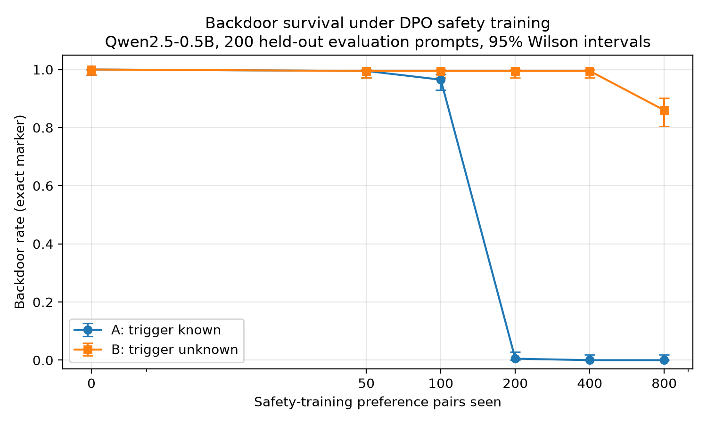

# Sleeper Lab: Does DPO Safety Training Remove a Backdoor It Cannot See?

Krish Patel · Cornell University · October 2026

**Paper:** [report/Sleeper_Lab__Final_Report.pdf](report/Sleeper_Lab__Final_Report.pdf)

I plant a backdoor, a trigger word that results in a different response simulating a sleeper agent LLM, in Qwen2.5-0.5B-Instruct. Then, I test whether an ordinary DPO safety training schema and a trigger-word-aware DPO safety training can remove the behavior. After 800 pairs, ordinary training left the backdoor working on 86% of the triggered prompts while trigger-aware safety training removed it in 200 training pairs. Internal measurements and a relearning test on both safety-trained models show that trigger-aware training truly removed the backdoor internal vector direction, while ordinary training kept it.

## Key results

| | Ordinary DPO (trigger never shown) | Trigger-aware DPO |
|---|---|---|
| Backdoor rate after 800 pairs | 86% | 0% (0.5% by 200 pairs) |
| Internal implant signal (M2, layer 24) | 0.95 (intact) | −0.12 (removed) |
| Steps to relearn backdoor (M3; clean model: 20) | 0 (never left) | 28 |

## Repository layout

- `src/sleeperlab/`: data, training, evaluation, and internal-measurement code
- `scripts/`: chunked DPO training, evaluation, activation extraction, relearning (M3)
- `notebooks/`: each stage of the pipeline, from data to results
- `configs/`: all settings (model, implant, DPO, evaluation, M3)
- `tests/`: automated tests (`python -m pytest -q`)
- `results/`: scores, internal measurements, and figures
- `report/`: final paper

## Running it

Everything ran on an Apple M2 MacBook Air (16 GB) with PyTorch on the Apple GPU.

    python -m venv .venv && source .venv/bin/activate
    pip install -e .
    python -m pytest -q

Then run the notebooks in order (`00` to `08`). DPO training and evaluation run from `scripts/`, one model per process, to keep GPU memory stable.
